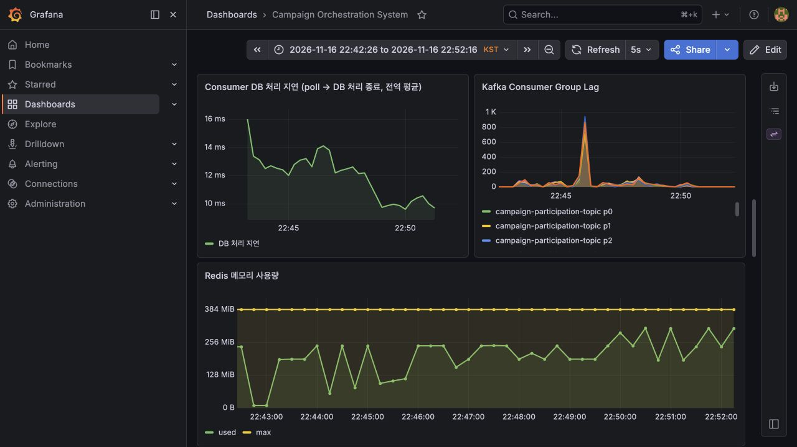
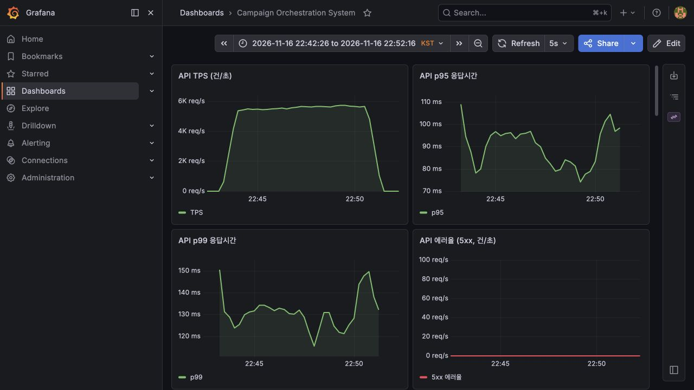
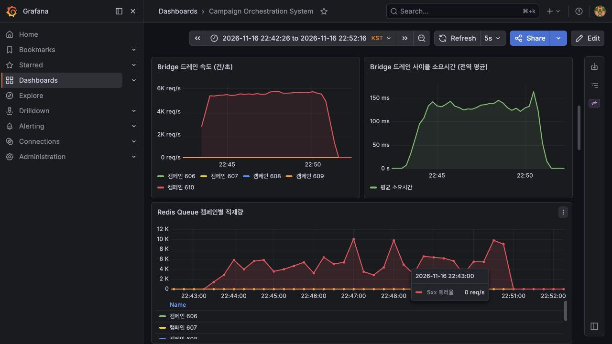
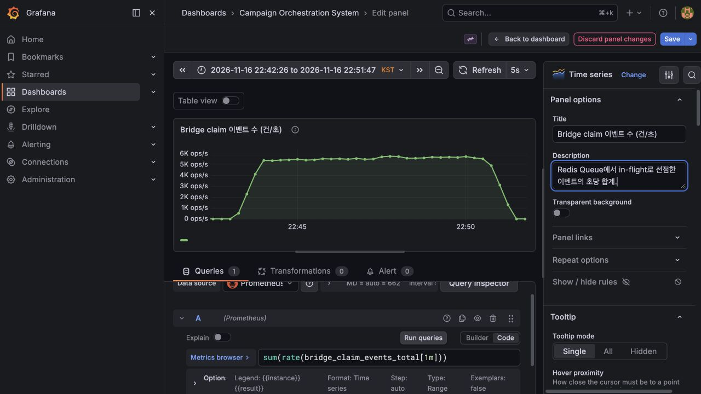

# 200만 건 안정 처리와 250만 건 정합성 검증

공용 앱 3대에서 200만 건을 안정적으로 처리한 뒤, 같은 구성에서 요청 총량을 250만 건까지 높여 정합성을 검증했다. 두 시험 모두 접수·Kafka 발행·DB 성공 건수가 목표와 일치했고 중복, DLQ, HTTP 5xx는 0건이었다.

| 지표 | 200만 건 기준선 | 250만 건 확장 검증 |
| --- | ---: | ---: |
| 평균 k6 처리량 | 5,712건/초 | 5,564건/초 |
| Kafka 그룹 lag 최대 | 1,041건 | 8,537건 |
| Redis Queue 최대 | 48,346건 | 11,571건 |
| Redis primary 메모리 최대 | 254.8MB | 328.2MB |
| Queue·in-flight·lag가 모두 0임을 확인 | 부하 종료 후 41초 | 부하 종료 후 41초 |
| 서버 p95 / p99 피크 | 151ms / 177ms | 108ms / 152ms |
| k6 p95 / p99 | 1,027ms / 1,233ms | 1,039ms / 1,259ms |

200만 건 기준선은 접수부터 DB 반영까지의 정합성과 부하 종료 후 배출을 확인한 결과다. 클라이언트 p95 1초 기준은 두 회차 모두 초과했다.

2026-11-16 캠페인 610에서 1만 건 예열 후 공용 앱 3대 고정, k6 3,000 VU로 250만 건을 실행했다. 본시험은 7분 29초에 끝났고 평균 처리량은 초당 5,564건이었다. HTTP 202 접수, Kafka 발행, DB 성공 건수는 모두 2,500,000건이었다. DB 순번 1~2,500,000, 사용자 및 순번 중복 0건, DLQ 0건, HTTP 5xx 0건을 확인했다.

| 관측 항목 | 결과 |
| --- | ---: |
| Redis Queue / in-flight 최대 | 11,571건 / 243건 |
| Queue·in-flight·Kafka lag 모두 0 확인 | 부하 종료 후 41초 |
| Redis primary 메모리 최대 / 하네스 중단 기준 | 328.2MB / 342MB |
| Grafana 서버 p95 / p99 피크 | 108ms / 152ms |
| k6 클라이언트 p95 / p99 | 1,039ms / 1,259ms |
| Bridge 선점 이벤트 / 성공 호출당 이벤트 중앙값 | 5,555건/초 / 9.98건 |

정합성 판정은 PASS였다. k6 p95는 1초 기준을 39ms 초과했고, 정합성 dry-run에서 종료 캠페인의 Redis 잔여 상태 경고 1건을 기록했다. 현재 구성에서 검증한 최대 총량은 250만 건이다. Redis primary의 최대 관측값은 하네스 중단 기준보다 13.8MB 낮았다.

## Kafka lag 스파이크

Grafana에서 여러 파티션의 lag가 같은 시간대에 상승했다. 하네스가 저장한 lag 시계열은 그룹 합계로, 모든 파티션이 동시에 올랐는지 판정하려면 파티션별 원시 표본이 필요하다. 아래는 같은 시각의 Kafka 발행과 DB 반영 카운터를 비교한 결과다.

| 시각 (KST) | 그룹 lag 합계 (건) | Bridge 발행 (건/초) | DB 반영 (건/초) |
| --- | ---: | ---: | ---: |
| 22:45:36 | 86 | 5,508 | 5,530 |
| 22:45:46 | 1,085 | 5,558 | 5,530 |
| 22:45:56 | 8,537 | 5,516 | 5,467 |
| 22:46:06 | 8,537 | 5,573 | 5,529 |
| 22:46:16 | 99 | 5,505 | 5,543 |

표는 10초 간격이며, 발행과 DB 반영은 1분 평균이다. lag가 높았던 구간에도 1분 평균 DB 반영률은 초당 약 5,500건이었다. 지속적인 Consumer 전체 중단을 뒷받침하는 증거는 없었다. 짧은 poll 중단이나 오프셋 커밋 지연은 두 지표만으로 구분할 수 없다. 사후 확인 시 모니터링 서버가 내려가 있어 파티션별 원본과 짧은 구간의 Consumer 카운터를 추가 조회하지 못했다.

